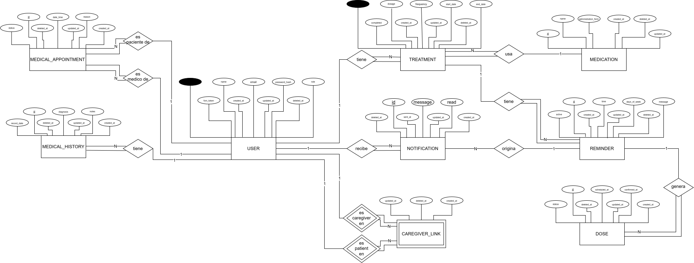

# Diagrama de entidad-relación

Basado en el [diccionario de datos](../README.md#diccionario-de-datos) del README. Notación de Chen: rectángulo = entidad, rombo = relación, óvalo = atributo, subrayado = clave primaria. Rectángulo y rombo de trazo doble marcan la entidad débil `CAREGIVER_LINK` y sus relaciones identificadoras. Línea doble marca participación total.

