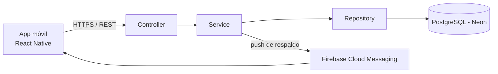

# Arquitectura del proyecto

## Arquitectura elegida

El backend sigue una arquitectura en capas (Controller → Service → Repository → Model), separando la exposición HTTP de la lógica de negocio y del acceso a datos:

- **Controller**: expone los endpoints REST y traduce entre DTOs y el dominio.
- **Service**: contiene la lógica de negocio y las reglas descriptas en el README (RN-01 a RN-09).
- **Repository**: acceso a datos vía JPA sobre las entidades del [esquema](../database/schema.sql).
- **Model**: entidades JPA que mapean 1 a 1 con las tablas del [diccionario de datos](../README.md#diccionario-de-datos).

## Tecnologías y justificación

| Capa | Tecnología | Justificación |
|---|---|---|
| Frontend / App móvil | React Native | Un mismo código para Android e iOS (RNF-01), evitando mantener dos bases nativas separadas. |
| Backend / API | Spring Boot (Java) | Framework maduro para APIs REST en capas, con soporte de primera clase para JPA, seguridad y testing. |
| Base de datos | PostgreSQL (hosteado en Neon) | Modelo relacional con relaciones y claves foráneas explícitas entre usuario, tratamiento, horarios y tomas; Neon evita administrar infraestructura propia. |
| Notificaciones | Notificaciones locales (app) + Firebase Cloud Messaging (FCM) | La app avisa a la hora de la toma con notificaciones locales; el backend envía un push de respaldo vía FCM (multiplataforma Android/iOS) unos 15 minutos después (por defecto; configurable con `medtracker.push.delay-minutes`), solo si la toma sigue `PENDING` (RF-06). El job de push está apagado por defecto (`medtracker.push.enabled=false`). |
| Autenticación | JWT propio | Mecanismo *stateless*, adecuado para un cliente móvil que no mantiene sesión de servidor. |
| Control de versiones | Git / GitHub | Repositorio único acordado para todo el equipo y el tutor. |

## Estado de la implementación

`/backend` (Spring Boot) implementa los módulos del README: autenticación con JWT y refresh token, usuarios, medicamentos, tratamientos, recordatorios, tomas, notificaciones, vínculos cuidador-paciente, citas e historial médico. `/frontend` (React Native con Expo y TypeScript) consume la API. El detalle de endpoints, reglas y configuración está en el [README](../README.md).
